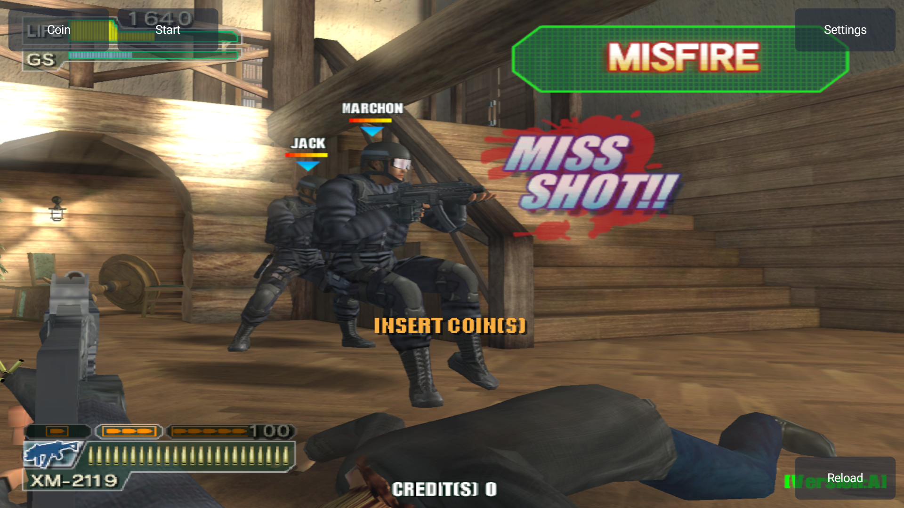
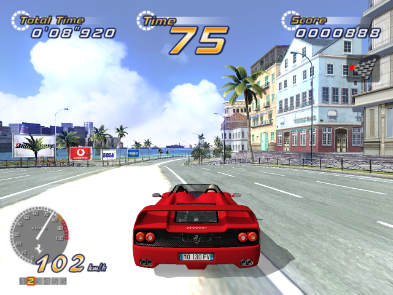

# Chihiro XBE Recomp

Six standalone Chihiro ports for **Linux x86-64** and **Android ARM64**, with their own launchers and bundled recompilation SDKs.

**[Download the preview release](https://github.com/CrownParkComputing/Chihiro-XBERecomp/releases/tag/v0.1.0-preview.1) · [Setup guide](docs/SETUP.md) · [Compatibility](docs/COMPATIBILITY.md) · [Screenshots](docs/SCREENSHOTS.md)**

These are experimental ports. **Maximum Tune 1 and 2 currently have a black-screen issue and are not playable.** Game files are imported locally from the supported original archive and are not included in this repository or its downloads.

| Game | Linux x86-64 | Android ARM64 | Current status |
| --- | --- | --- | --- |
| [The House of the Dead III](ports/HOTD3) | [Linux](https://github.com/CrownParkComputing/Chihiro-XBERecomp/releases/download/v0.1.0-preview.1/HOTD3-Linux-x86_64.tar.gz) | [APK](https://github.com/CrownParkComputing/Chihiro-XBERecomp/releases/download/v0.1.0-preview.1/HOTD3-Android-arm64.apk) | Experimental; native gameplay exercised; updated APK installed/imported on Retroid. |
| [OutRun 2](ports/OutRun2) | [Linux](https://github.com/CrownParkComputing/Chihiro-XBERecomp/releases/download/v0.1.0-preview.1/OutRun2-Linux-x86_64.tar.gz) | [APK](https://github.com/CrownParkComputing/Chihiro-XBERecomp/releases/download/v0.1.0-preview.1/OutRun2-Android-arm64.apk) | Experimental; native driving exercised; updated APK installed/imported on Retroid. |
| [Virtua Cop 3](ports/VCop3) | [Linux](https://github.com/CrownParkComputing/Chihiro-XBERecomp/releases/download/v0.1.0-preview.1/VCop3-Linux-x86_64.tar.gz) | [APK](https://github.com/CrownParkComputing/Chihiro-XBERecomp/releases/download/v0.1.0-preview.1/VCop3-Android-arm64.apk) | Experimental; local co-op implementation; riot-shield/limb rendering still needs scene validation. |
| [Wangan Midnight Maximum Tune](ports/MaximumTune1) | [Linux](https://github.com/CrownParkComputing/Chihiro-XBERecomp/releases/download/v0.1.0-preview.1/MaximumTune1-Linux-x86_64.tar.gz) | [APK](https://github.com/CrownParkComputing/Chihiro-XBERecomp/releases/download/v0.1.0-preview.1/MaximumTune1-Android-arm64.apk) | Development preview: boots and draws menus internally, but the display remains black. Racing unavailable. |
| [Wangan Midnight Maximum Tune 2](ports/MaximumTune2) | [Linux](https://github.com/CrownParkComputing/Chihiro-XBERecomp/releases/download/v0.1.0-preview.1/MaximumTune2-Linux-x86_64.tar.gz) | [APK](https://github.com/CrownParkComputing/Chihiro-XBERecomp/releases/download/v0.1.0-preview.1/MaximumTune2-Android-arm64.apk) | Development preview: boots and draws menus internally, but the display remains black. Racing unavailable. |
| [Ghost Squad](ports/GhostSquad) | [Linux](https://github.com/CrownParkComputing/Chihiro-XBERecomp/releases/download/v0.1.0-preview.1/GhostSquad-Linux-x86_64.tar.gz) | [APK](https://github.com/CrownParkComputing/Chihiro-XBERecomp/releases/download/v0.1.0-preview.1/GhostSquad-Android-arm64.apk) | Attract sequence renders on Linux and Retroid; missing upper arms/thighs restored. Full gameplay/input/audio validation pending. |

## Screenshots

| Ghost Squad — Retroid Pocket Flip2 | OutRun 2 — Linux |
| --- | --- |
|  |  |

[Open the full gallery and geometry comparison](docs/SCREENSHOTS.md). Screenshots document observed behavior; they do not imply complete gameplay support.

## Install

**Android:** install the game's APK on Android 13 or later with ARM64 and Vulkan 1.1 support. Open it, choose **Import Chihiro .7z**, select the matching archive, wait for verification, then use **Start game**. Original archives can remain on SD; extraction uses app storage. Retroid Pocket Flip2 has been used for installation/import checks on all six titles and a Ghost Squad rendering check.

**Linux:** extract the game's `.tar.gz` into a writable folder and run `./Start.sh`. Install Python 3.11+, Zenity, 7-Zip (`7z`), and a Vulkan driver. SDL3, DXC and C++ runtime libraries are bundled where required. Check the included `release.json` for minimum glibc and architecture requirements.

The release includes `SHA256SUMS`, a machine-readable manifest, and a screenshot archive. APK updates keep the same package IDs and signing identities as the local standalone ports.

## Source and building

Each directory under `ports/` is independently buildable. For example:

```sh
cd ports/GhostSquad
python3 tools/prepare_game.py '/path/to/Ghost Squad.7z'
python3 tools/build_native.py --jobs 3
./run.sh
python3 tools/build_android.py --jobs 3
```

Native compilation needs Clang, CMake, Ninja, Python and Vulkan development files. Android builds use JDK 17, Android SDK/build tools and NDK; see the per-port documentation. Dependencies are pinned by the included SDK. Build and game-data directories are ignored.

The source includes the four-world-matrix skinning, paired shader operand, shared depth attachment and resource ownership corrections used for the latest builds. See [renderer validation](docs/RENDERER.md).

## Credits and licenses

Based on [XboxXBE-Recomp](https://github.com/TGP482/XboxXBE-Recomp) and the portable runtime work described in each port's `UPSTREAM.md`. Preserve the MIT license, SDK licenses, third-party notices, Android dependency licenses and bundled library notices. Game screenshots show their respective rights holders' artwork; they are not covered by the source-code MIT license.
