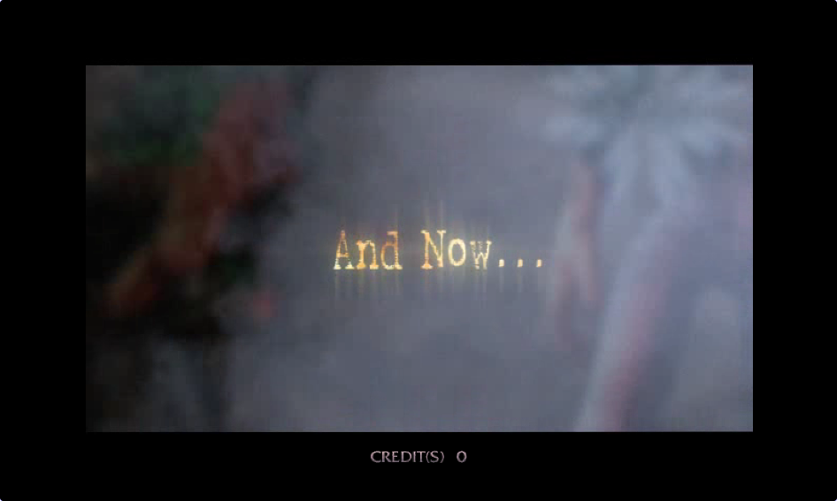
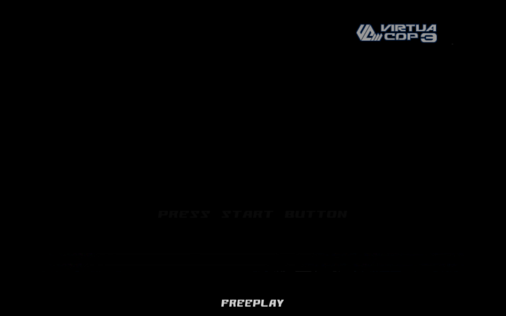
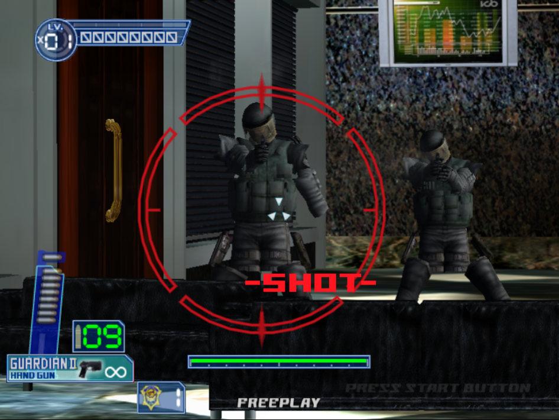
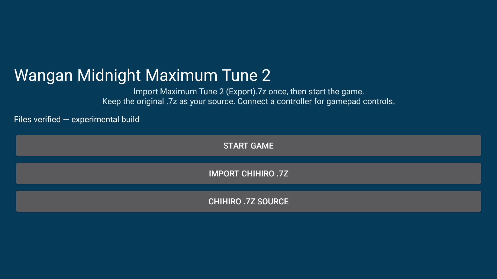
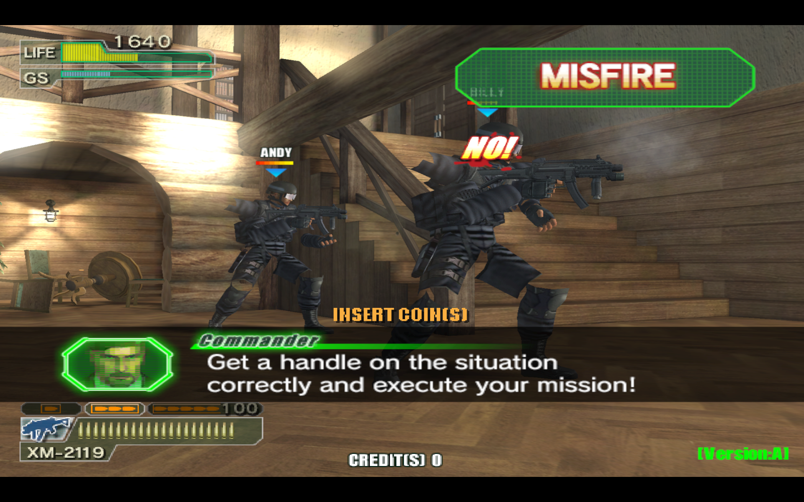
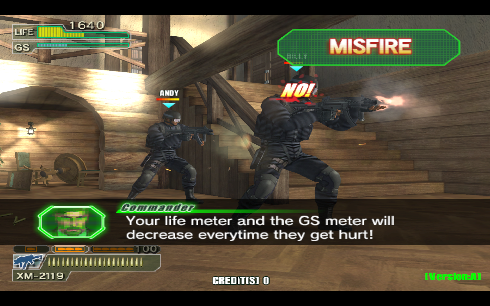

# Screenshots and observed behavior

Real captures from the local Linux ports and Retroid Pocket Flip2. Experimental status and known failures are documented beside the downloads. Game artwork belongs to its respective rights holders and is not relicensed under MIT.

## HOTD3

HOTD3 — current Linux intro sequence.

## OutRun 2

OutRun 2 — an earlier native driving check.

## Virtua Cop 3

Virtua Cop 3 — current Linux attract/title sequence.

## Virtua Cop 3

Virtua Cop 3 — earlier mission capture showing the remaining limb/shield rendering issue. This scene has not been verified fixed.

## Maximum Tune 1

Maximum Tune 1 — verified Android import launcher on Retroid. This is not an in-game rendering screenshot; the game currently has a black screen.

## Maximum Tune 2

Maximum Tune 2 — verified Android import launcher on Retroid. Racing is unavailable while the black-screen problem remains.

## Ghost Squad

Ghost Squad — current Retroid Pocket Flip2 attract sequence, with complete character arms and thighs.

## Ghost Squad

Ghost Squad — Linux before the skinning correction, with missing upper arms and thighs.

## Ghost Squad

Ghost Squad — Linux after the correction at approximately the same attract timing. Characters animate between captures; these are not identical frames.

